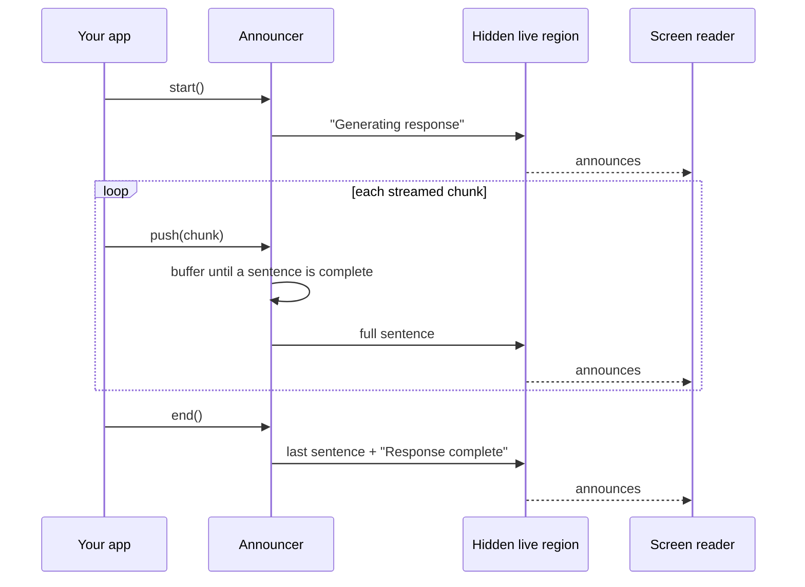

# ai-a11y

AI chat answers that screen readers can follow.

> Status: early development. The API may change before 1.0.

## The problem

AI chats stream answers word by word. Sighted users watch the text appear. Screen reader users get one of two things:

**Noise.** The screen reader restarts on every new word:

> "The" … "The best" … "The best way" … "The best way to" …

**Silence.** Nothing is announced. They don't know an answer is coming, when it ends, or if it failed.

The fix depends on each screen reader's quirks. Most teams don't have time to test NVDA, JAWS, VoiceOver, and TalkBack, so most AI chats ship broken.

## The fix

ai-a11y announces the answer one sentence at a time, with a clear start and end:

> "Generating response." → "The best way to center a div is flexbox." → "Response complete."

Your visible answer stays as it is. A hidden live region does the talking.

## How it works



## Usage

```sh
npm install ai-a11y
```

```ts
import { createAnnouncer } from "ai-a11y";

const announcer = createAnnouncer();

announcer.start();
for await (const chunk of stream) {
  render(chunk);
  announcer.push(chunk);
}
announcer.end();
```

### Options

```ts
createAnnouncer({
  locale: "pt-BR",
  messages: {
    start: "Gerando resposta",
    complete: "Resposta completa",
  },
});
```

Sentences are split with `Intl.Segmenter`, so any language works.

## Roadmap

- Rate limiting for fast streams
- Stop, error, and code block announcements
- Adapters: React, Vercel AI SDK, web component
- Screen reader support matrix

## Contributing

Commits follow [Conventional Commits](https://www.conventionalcommits.org/). Versions follow [Semantic Versioning](https://semver.org/spec/v2.0.0.html). Changes are logged in [CHANGELOG.md](./CHANGELOG.md).

```sh
npm install
npm run check
```

## License

MIT
