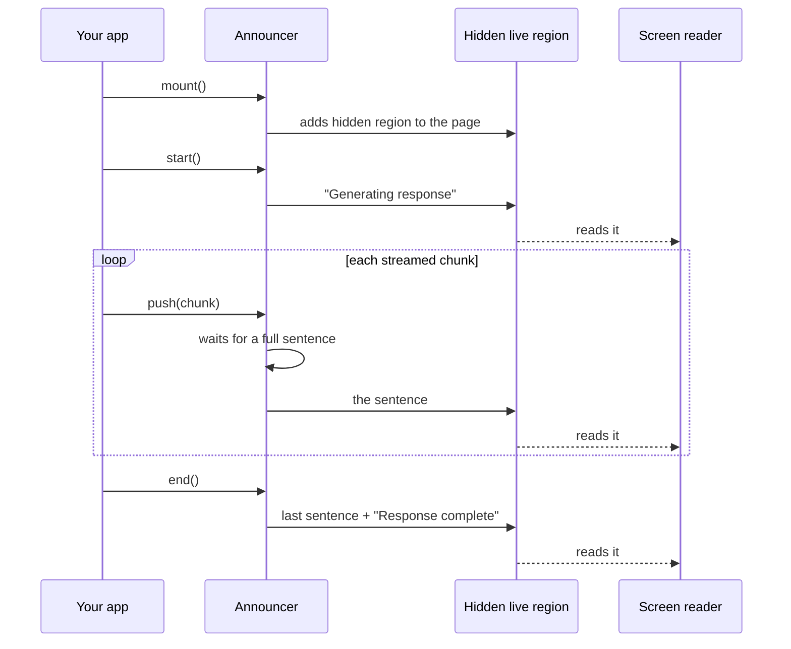

# ai-a11y

AI chat answers that screen readers can follow.

> Status: early development. The API may change before 1.0.

## Context

AI chats are now part of most apps: support, search, docs, coding tools.

They show answers as they are written, word by word. This is called streaming. It makes the app feel fast.

Laws also changed. The [European Accessibility Act](https://ec.europa.eu/social/main.jsp?catId=1202) applies since June 2025. Apps must work for people with disabilities.

## The problem

Blind people use screen readers: software that reads the screen out loud.

AI chats write answers word by word. Screen readers don't handle that well:

- **They repeat.** Every new word restarts the reading: "The" … "The best" … "The best way" …
- **Or they stay silent.** The user never hears the answer, or doesn't know it finished.

So for screen reader users, most AI chats are broken.

## Motivation

Everyone should be able to use your AI chat, including people who can't see the screen.

Today that is hard to get right:

- **No library exists.** Each team solves it alone, or doesn't.
- **Screen readers behave differently.** A fix that works in VoiceOver can fail in NVDA or JAWS.
- **Testing takes time.** Few teams test with real screen readers.

ai-a11y solves it once, so every team can reuse it. Testing on real screen readers is on the [roadmap](#roadmap).

## The fix

ai-a11y reads the answer one sentence at a time, and says when it starts and ends:

> "Generating response." → "The best way to center a div is flexbox." → "Response complete."

Your chat looks the same. Only what the screen reader hears changes.

## Why not build it yourself?

Getting this right takes more than an `aria-live` attribute. ai-a11y handles:

| What                                                                           | Status  |
| ------------------------------------------------------------------------------ | ------- |
| Keep the visible answer out of the live region, so it doesn't flood the reader | Done    |
| Add the hidden region before the first message, since late regions get ignored | Done    |
| Wait for full sentences, in any language                                       | Done    |
| Work with server rendering and React StrictMode                                | Done    |
| Slow down when text arrives too fast                                           | Planned |
| Repeat a message that is the same as the last one                              | Planned |
| Announce stop, error, and code blocks                                          | Planned |
| Test on NVDA, JAWS, VoiceOver, and TalkBack                                    | Planned |

Most teams don't know these issues exist. Sighted engineers never hear them.

## How it works



## Imports

| Import          | For                                |
| --------------- | ---------------------------------- |
| `ai-a11y`       | Any framework, or plain JavaScript |
| `ai-a11y/react` | React 18+                          |

One package. Import only what you use: unused code is tree-shaken away, and React is an optional peer dependency.

## Usage

```sh
pnpm add ai-a11y
```

```ts
import { createAnnouncer } from "ai-a11y";

const announcer = createAnnouncer();
const unmount = announcer.mount();

announcer.start();
for await (const chunk of stream) {
  render(chunk);
  announcer.push(chunk);
}
announcer.end();
```

Call `unmount()` when the chat goes away.

### React

```sh
pnpm add ai-a11y
```

```tsx
import { useAnnouncer } from "ai-a11y/react";

function Chat() {
  const announcer = useAnnouncer();

  async function ask(question: string) {
    announcer.start();
    for await (const chunk of streamAnswer(question)) {
      announcer.push(chunk);
    }
    announcer.end();
  }
  // render your chat as usual
}
```

The hook adds the hidden region on mount and removes it on unmount. It also returns `status` and `announcement`.

### Options

```ts
createAnnouncer({
  locale: "pt-BR",
  messages: {
    start: "Gerando resposta",
    complete: "Resposta completa",
  },
});
```

Sentences are split with `Intl.Segmenter`, so any language works.

### State

```ts
announcer.getState(); // { status: "idle" | "streaming" | "complete", announcement }
const unsubscribe = announcer.subscribe((state) => console.log(state));
```

Framework adapters use this to stay in sync.

## Roadmap

- Rate limiting for fast streams
- Stop, error, and code block announcements
- Adapters: Svelte, Vercel AI SDK, web component
- Screen reader support matrix

## Contributing

Requires [asdf](https://asdf-vm.com/) (see `.tool-versions`) and pnpm.

```sh
asdf install
pnpm install
pnpm check
```

Commits follow [Conventional Commits](https://www.conventionalcommits.org/). Versions follow [Semantic Versioning](https://semver.org/spec/v2.0.0.html). Changes are logged in [CHANGELOG.md](./CHANGELOG.md).

## License

[MIT](./LICENSE) © Helder Berto
